<p align="center">
  
</p>

<h1 align="center">Porch</h1>

<p align="center">
  <strong>Self-hosted identity and single sign-on for families, friend groups and homelabs.</strong><br>
  Sign in once with Google or a backup login, and open every app you were given access to. One Go binary, one SQLite
  file.
</p>

<p align="center">
  <a href="https://aurimasniekis.github.io/go-porch/">Documentation</a> ·
  <a href="https://aurimasniekis.github.io/go-porch/guide/try-locally">Try it locally</a> ·
  <a href="https://aurimasniekis.github.io/go-porch/guide/connect-an-app">Connect an app</a> ·
  <a href="https://aurimasniekis.github.io/go-porch/security/">Security model</a>
</p>

<picture>
  <source media="(prefers-color-scheme: dark)" srcset="site/public/screenshots/launcher-dark.png">
  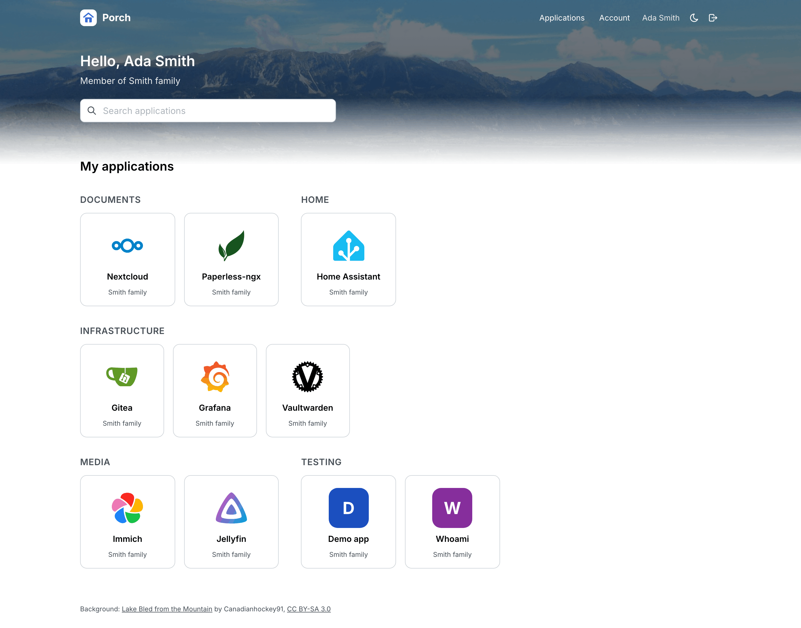
</picture>

> [!NOTE]
> **Porch 0.1.0** is the first release: see the [changelog](CHANGELOG.md) and [Deploy](#deploy).

## Why

A family or a homelab ends up with a dozen self-hosted apps, each with its own accounts. Shared passwords leak, nobody
removes the account of the friend who moved away, and the kids' tablet can reach the admin panel. Authentik and
Keycloak solve this, but they are large systems to run for ten people.

Porch is the small version. People sign in with the Google accounts they already have (or a whole Google Workspace
domain), plus a strict **backup login** for when Google is unavailable. Apps that speak OpenID Connect use Porch as
their login provider; everything else sits behind **forward-auth** in your reverse proxy. One installation can host
several families that keep their own apps private and share some on purpose.

## How it works

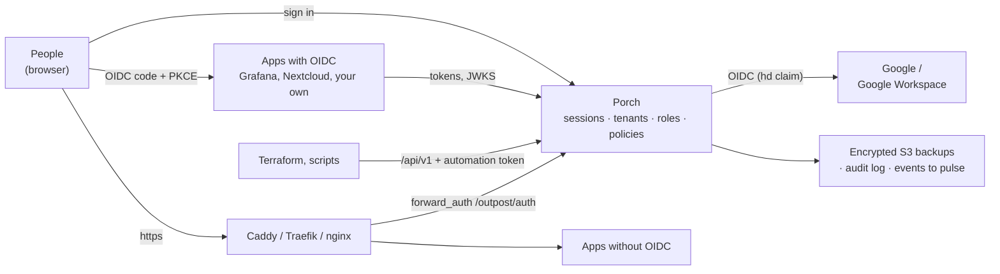

1. Run `porch` behind your reverse proxy, create the owner with a one-time setup token, and add Google as an identity
   provider.
2. Create a **tenant** per family or group. Enroll people by invitation, or let a domain rule enroll everyone whose
   Google Workspace token carries `hd=smith.example`.
3. Register **applications**: OIDC clients get a client ID and secret; forward-auth apps get a host name. Decide who may
   open each one with roles, groups and conditions.
4. People sign in once and see a launcher with the apps they may use. Porch issues tokens or identity headers that say
   who they are and which tenant let them in.

**Key features**

- **OpenID Connect provider.** Authorization code with PKCE (S256 required), exact redirect URIs, RFC 9068 JWT access
  tokens bound to an audience, rotating refresh tokens with reuse detection, revocation, introspection,
  RP-initiated logout and client credentials for service accounts. ES256 by default, RS256 per client. The OpenID
  conformance suite (Basic and Config OP) passes on a local run.
- **Google and Google Workspace sign-in.** Workspace enrollment uses the validated `hd` claim from the ID token, never
  the email suffix. Identities are linked by issuer and subject, never by matching email. Sessions recheck Google
  silently every hour.
- **A backup login that is hard to abuse.** A password plus your own titled recovery answers ("Street of the summer
  house"), hashed together with Argon2id. One wrong attempt locks the backup login for 6 hours, enforced atomically
  even against parallel attempts, while Google sign-in keeps working. Offline recovery needs the host and the key file.
- **Tenants with real isolation.** Every tenant-scoped row carries its tenant, and composite foreign keys stop a row
  from pointing into another tenant. Apps are shared across tenants only by an explicit share.
- **Roles, groups and policies.** Permissions such as `app:access`, roles and role bundles, nested groups, resource
  hierarchies, deny policies and [`expr`](https://expr-lang.org) conditions (`context.hour >= 7 && context.hour < 21`).
  Every decision comes with an explain trace, and a simulator tries "what if" contexts.
- **Delegated administration.** Hand a parent the right to manage their family's members and apps. Nobody can grant
  more than they hold, and tenant roles never confer installation rights.
- **Forward-auth** for Caddy `forward_auth`, Traefik `ForwardAuth` and nginx `auth_request`, with host-only cookies,
  validated redirects and configurable identity headers.
- **Built for automation.** A management API with an OpenAPI 3.1 document, `ETag`/`If-Match`, `Idempotency-Key`,
  scoped automation tokens and a [Terraform provider](https://github.com/aurimasniekis/terraform-provider-porch).
- **Backups Porch itself cannot read.** Snapshots are age-encrypted to an offline recipient and uploaded to
  S3-compatible storage (tested with MinIO, versioning and object lock). A restore drill invalidates every session
  and replaces the signing keys.
- **Operable.** A hash-chained audit log, Prometheus metrics on a private listener, a Grafana dashboard, alert rules
  with runbooks, domain events to [pulse](https://github.com/aurimasniekis/go-pulse), a read-only container image and
  a sandboxed systemd unit.

Porch is **single-node** (one process, one SQLite database) and keeps every tenant in the same database under the same
key. Tenant isolation protects families from each other's mistakes and from Porch bugs that the tests catch. It is
not a boundary against someone who controls the host.

## Screenshots

| | |
|---|---|
| 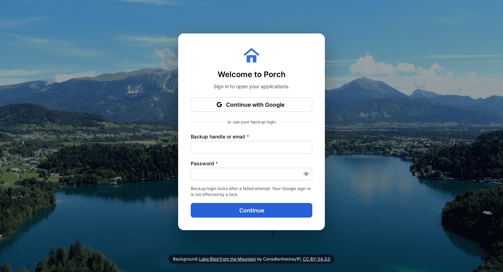<br>**Sign in with Google or the backup login** | 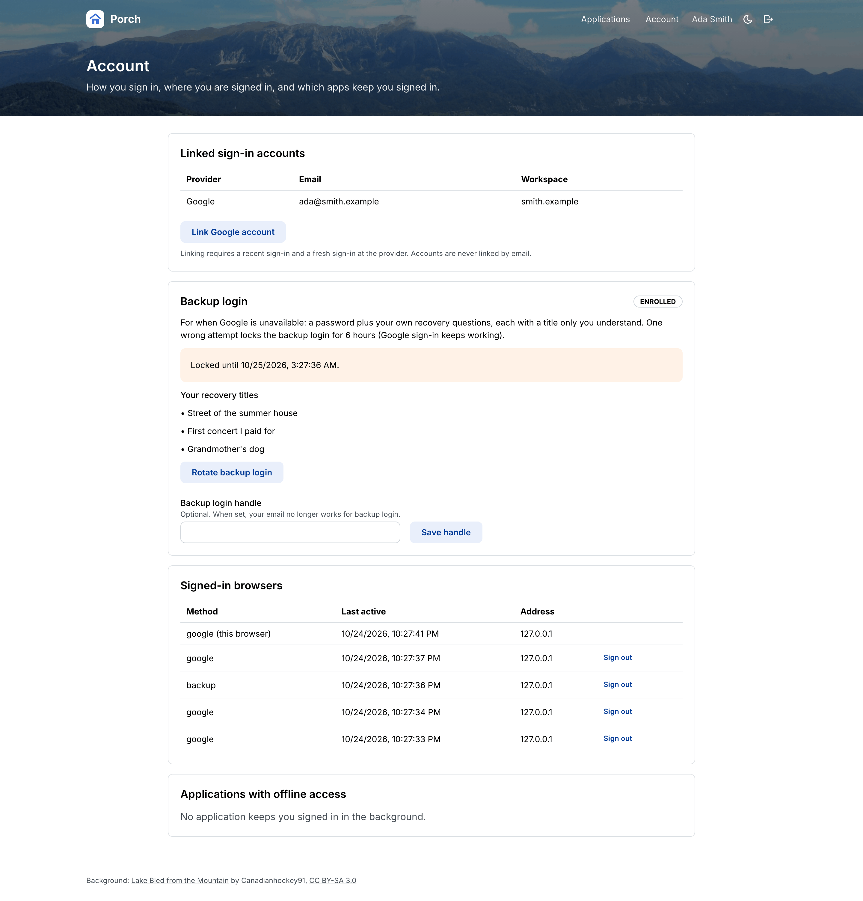<br>**Your sessions and backup login** |
| 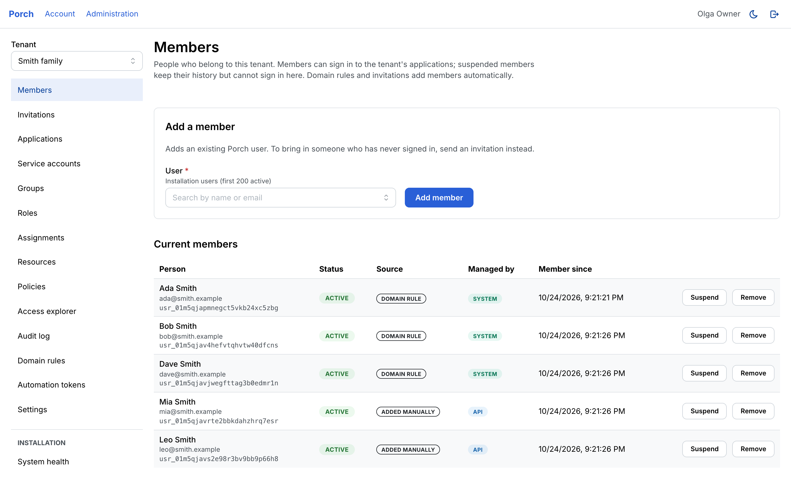<br>**Members and where they came from** | 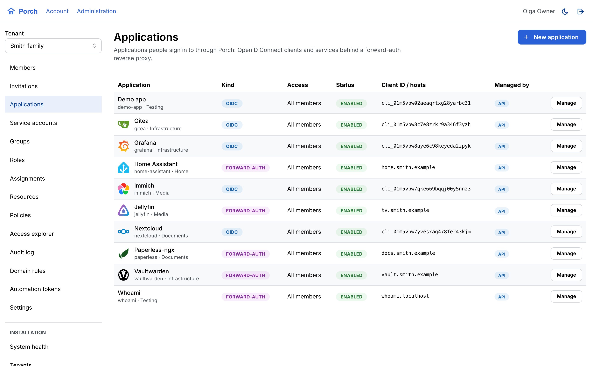<br>**OIDC and forward-auth applications** |
| 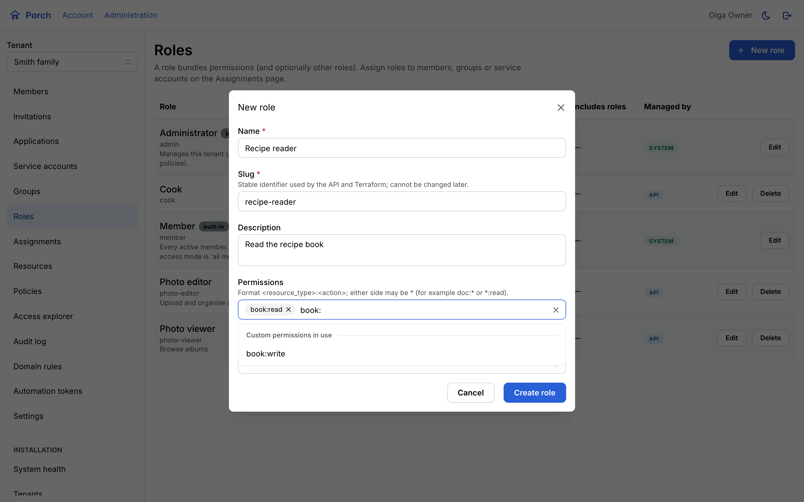<br>**Roles from permissions** | 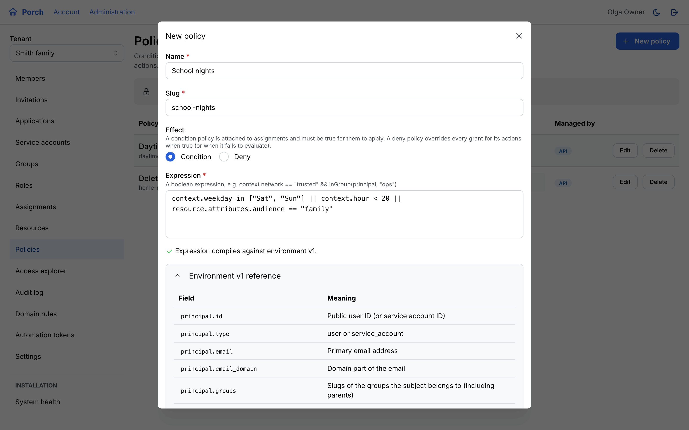<br>**Conditions with live validation** |
| 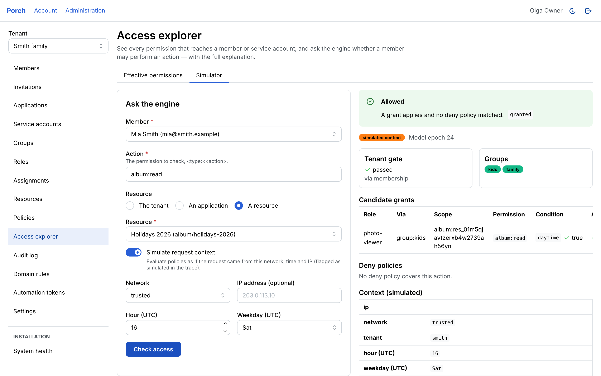<br>**Every decision explained** | 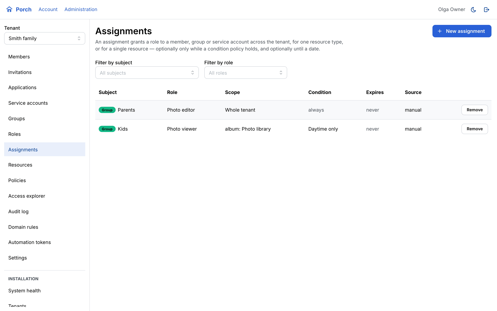<br>**Assignments with conditions** |
| 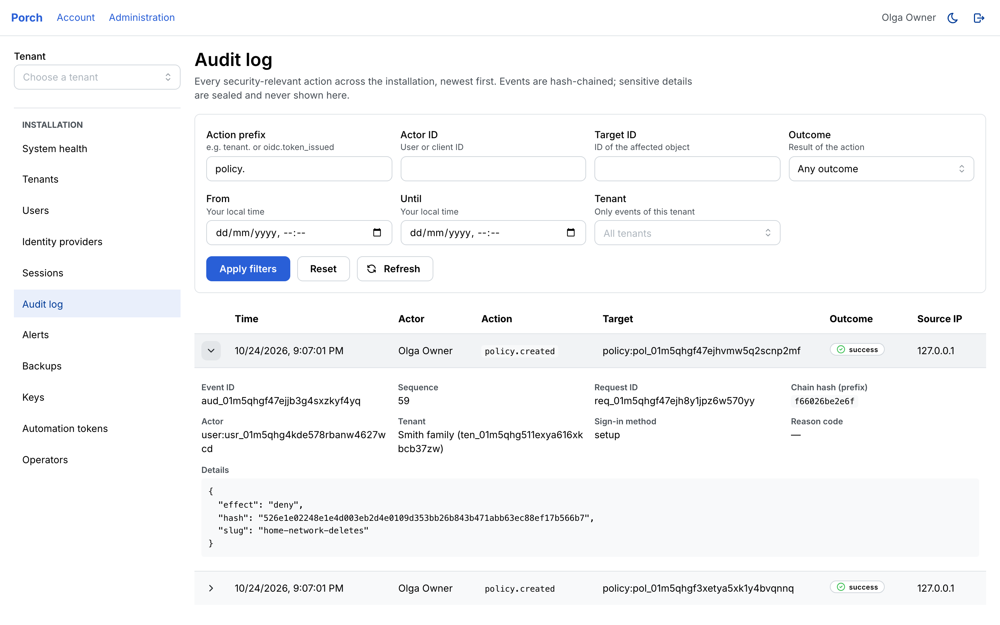<br>**Hash-chained audit log** | 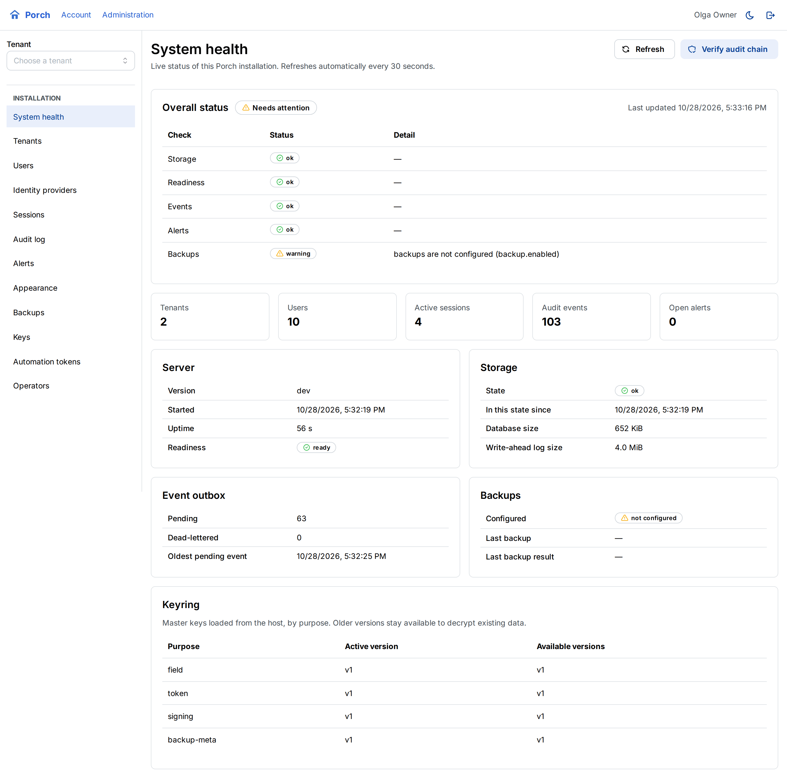<br>**System health** |

## Quick start

### Try it on your machine

Needs Docker with Compose v2.24+, `python3` and `curl`. Nothing talks to the internet: the stack includes a fake
Google that signs in whoever you pick.

```sh
git clone https://github.com/aurimasniekis/go-porch.git && cd go-porch
deploy/demo/up.sh       # Caddy, Porch, a fake Google, a demo OIDC app and whoami behind forward-auth
```

Open `https://auth.localhost:28443`, choose **Continue with Google** and pick **Ada Smith**. Then open the demo app
and whoami from her launcher. `up.sh` also prints the owner's backup login for the admin UI. The
[local guide](https://aurimasniekis.github.io/go-porch/guide/try-locally) suggests what to try next.
`deploy/demo/down.sh` removes everything.

### Deploy

Releases publish a multi-arch image (linux/amd64, linux/arm64) to `ghcr.io/aurimasniekis/go-porch` and Docker Hub
(`docker.io/aurimasniekis/porch`), and archives for
linux/amd64, linux/arm64 and darwin/arm64 with `SHA256SUMS`, SBOMs and build provenance. With Docker Compose
(read-only container, UID 65532, all capabilities dropped):

```sh
export V=0.1.0
gh attestation verify oci://ghcr.io/aurimasniekis/go-porch:$V --repo aurimasniekis/go-porch
git clone --depth 1 --branch v$V https://github.com/aurimasniekis/go-porch.git && cd go-porch/deploy
cp .env.example .env && $EDITOR .env                       # PD_PUBLIC_URL=https://auth.example.com
printf 'PD_IMAGE=ghcr.io/aurimasniekis/go-porch\nPD_VERSION=%s\n' "$V" >> .env
docker compose pull
docker compose --profile init run --rm keygen              # secrets/porch.kek: back it up offline
docker compose run --rm --no-deps porch admin setup-token  # one-time setup token
docker compose up -d                                       # then open https://auth.example.com/setup
```

Put a TLS reverse proxy in front of `127.0.0.1:28080`. For the binary with systemd, building from source, and all the
details, read [Install](https://aurimasniekis.github.io/go-porch/operators/quickstart).

## Connect your apps

**OpenID Connect.** Register the app in the admin UI (or the API), then give it Porch's issuer, the client ID and the
secret:

| Setting | Value |
|---|---|
| Issuer / discovery | `https://auth.example.com` (`/.well-known/openid-configuration`) |
| Scopes | `openid profile email`, plus `offline_access` for refresh tokens and `groups` for group slugs |
| PKCE | S256 |
| User ID | `sub`, a stable Porch user ID (never the email) |

**Forward-auth.** For apps without OIDC, let the proxy ask Porch:

```caddyfile
photos.example.com {
	request_header -X-Porch-*                     # clients must never send identity headers
	handle /.porch/* {
		reverse_proxy porch:8080                  # Porch's sign-in callback on this host
	}
	handle {
		forward_auth porch:8080 {
			uri /outpost/auth
			copy_headers X-Porch-User X-Porch-Email X-Porch-Name X-Porch-Groups X-Porch-Tenant
		}
		reverse_proxy photos:8080 {
			header_up Cookie "__Host-porch_fa=[^;]*(;\s*)?" ""   # Porch's cookie stays with Porch
		}
	}
}
```

Traefik and nginx examples, and what forward-auth cannot protect, are in the
[forward-auth guide](https://aurimasniekis.github.io/go-porch/operators/forward-auth). The
[integration matrix](https://aurimasniekis.github.io/go-porch/guide/integrations) says which apps were actually tested.

**Terraform.** Manage tenants, people, apps, roles and policies as code:

```hcl
resource "porch_role_assignment" "kids_media" {
  tenant              = porch_tenant.smith.id
  subject_type        = "group"
  subject_id          = porch_group.kids.id
  role_id             = porch_role.media_viewer.id
  condition_policy_id = porch_policy.daytime.id   # context.hour >= 7 && context.hour < 21
}
```

The provider is on the [Terraform Registry](https://registry.terraform.io/providers/aurimasniekis/porch) as
`aurimasniekis/porch`. See [API and Terraform](https://aurimasniekis.github.io/go-porch/guide/automation).

## Status

Milestones M0–M7 of the [plan](docs/PLAN.md) are implemented and tested. Every claim has evidence in the
[implementation matrix](docs/IMPLEMENTATION_MATRIX.md), and the last full acceptance run is in
[test/acceptance](test/acceptance/results-2026-10-24.md).

| Area | Evidence |
|---|---|
| Sign-in, sessions, backup login, OIDC, forward-auth, admin UI | Go race tests, 36 Playwright browser tests with axe (WCAG 2.1 AA) and zero CSP violations |
| OpenID Connect | OpenID conformance suite, Basic and Config OP: 0 failures (local run, not certification) |
| Backups | encrypt, upload to MinIO, verify and restore into a clean data directory |
| Terraform | provider acceptance tests and a 69-resource scenario against a real Porch, in CI |
| Events | delivered to a running pulsed, including after a pulse outage, with no duplicates after a restart |
| Security | internal review (3 high, 11 medium, low items), all fixed with regression tests |

Planned next: front- and back-channel logout, passkeys and high availability ([backlog](docs/BACKLOG.md)).

## Documentation

Everything is on the **[documentation website](https://aurimasniekis.github.io/go-porch/)**:

- [Guide](https://aurimasniekis.github.io/go-porch/guide/what-is-porch): concepts, trying it locally, signing in,
  connecting an application, administering a tenant, API and Terraform.
- [Operators](https://aurimasniekis.github.io/go-porch/operators/): installing, identity providers and domains, backup
  login and recovery, forward-auth, backups, monitoring and runbooks.
- [Security](https://aurimasniekis.github.io/go-porch/security/): the threat model and the design decisions (ADRs).
- [Reference](https://aurimasniekis.github.io/go-porch/reference/flows): flows, architecture, database schema and the
  API.

Engineering documents live in [docs/](docs/): [architecture](docs/ARCHITECTURE.md),
[threat model](docs/THREAT_MODEL.md), [decisions](docs/DECISIONS.md), [flows](docs/FLOWS.md) and
[backlog](docs/BACKLOG.md).

## Security

Read the [security model](https://aurimasniekis.github.io/go-porch/security/) before deploying: it lists what Porch
defends against and what it does not. Report vulnerabilities privately; see [SECURITY.md](SECURITY.md).

## Contributing

See [CONTRIBUTING.md](CONTRIBUTING.md).

## License

[Apache License 2.0](LICENSE). See also [NOTICE](NOTICE).
