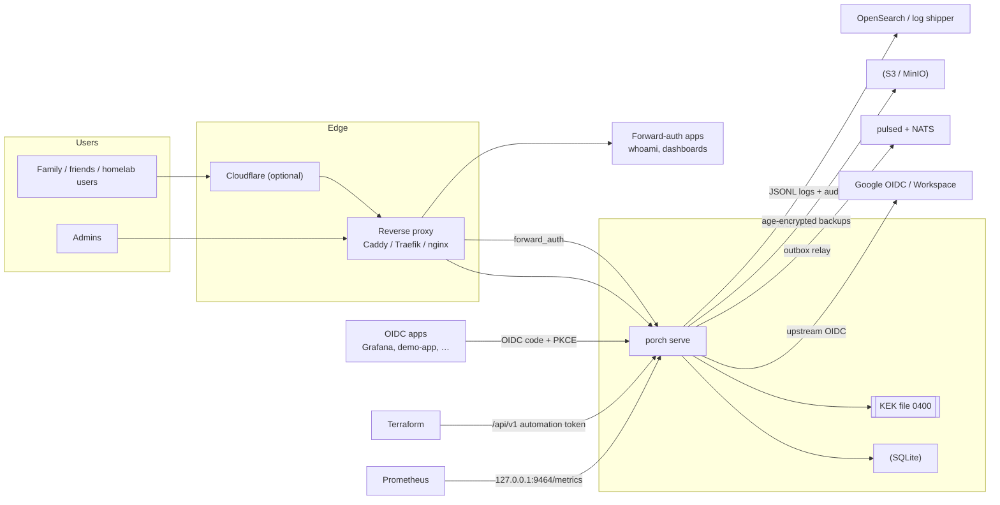
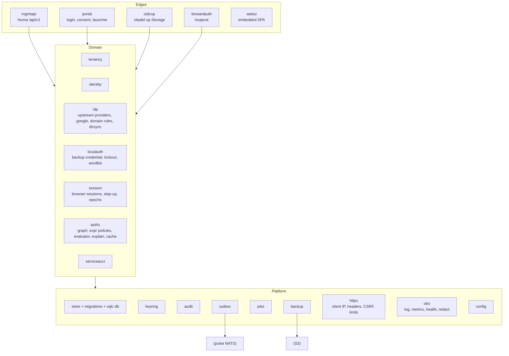
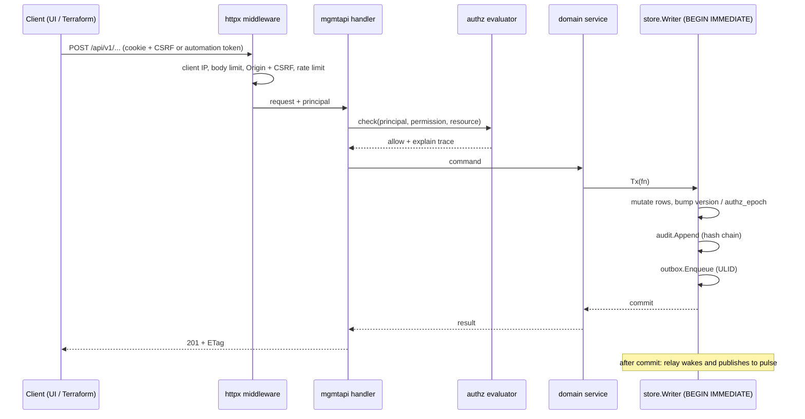

# Architecture

Porch is a **modular monolith**: one Go binary (`porch`), one SQLite database, one key-encryption key (KEK) file.
Modules are Go packages under `internal/` with explicit dependencies; there is no network hop between them.

## Context

## Listeners

| Listener | Default | Serves |
|---|---|---|
| Public | `127.0.0.1:8080` (TLS optional, client-cert CA for Cloudflare Authenticated Origin Pulls) | Login/consent portal, user portal, admin UI, `/api/v1`, OIDC provider (`/.well-known/openid-configuration`, `/oauth2/*`, `/jwks`), forward-auth outpost (`/outpost/*`), per-app callbacks |
| Management | `127.0.0.1:9464` | `/metrics`, `/healthz`, `/readyz`, optional pprof (off by default) |

## Packages

Rules:

- Domain packages never import edge packages. Edges never touch `store/db` directly for writes; they call domain services.
- Every write goes through `store.Writer.Tx` (single writer, `BEGIN IMMEDIATE`). Audit events and outbox rows are appended
  **inside the same transaction** as the change they describe.
- Transaction callbacks perform no network I/O, sleeps or channel operations (enforced by the `txscope` analyzer).
- Tenant-scoped repository functions take a `tenancy.Scope`, which can only be constructed after a membership/share check.

## Data flow of a write

## Persistence

- SQLite via `modernc.org/sqlite` (pure Go, `CGO_ENABLED=0`), WAL, `synchronous=FULL`, `foreign_keys=ON`, `trusted_schema=OFF`.
- Times are stored as UTC Unix microseconds (`INTEGER`). IDs are `<prefix>_<26 Crockford base32>` encoding UUIDv7.
- Secrets at rest are sealed with keyring purpose keys (AES-256-GCM, AAD = `table|column|row-id`); token lookups use
  HMAC-SHA-256 under the `token` purpose key, never plain SHA-256 of a low-entropy value.
- Schema: see [SCHEMA.md](SCHEMA.md).

## Tenancy model

One **installation** contains many **tenants** (a family, a friend group, a homelab). Users are installation-wide
identities; they join tenants through **memberships**. Applications, groups, roles, resources, policies and assignments
are tenant-scoped. Installation **operators** are a separate concept (table `installation_role_assignments`): tenant
roles never confer installation capabilities, and installation roles do not silently grant tenant data access
(operators act on tenants through explicit, audited operations).

Isolation is **logical** (same process, same database, same KEK) and enforced in the schema with composite foreign keys
`(tenant_id, id)`. It protects tenants from each other's admins and from application bugs that pass a wrong ID; it is
not a boundary against host compromise or a bug in Porch's own authorization code. See ADR-0004.

## Time and background work

- `jobs` (leased SQLite queue) runs: session cleanup, domain-rule re-evaluation, federated `prompt=none` recheck
  scheduling, directory sync, signing-key rotation, keyring reseal, audit retention, backup schedule, outbox relay wakeups.
- The outbox relay is a single goroutine; it never blocks request handling.

## Failure behaviour

| Dependency down | Effect |
|---|---|
| Google | New federated logins fail; existing sessions continue until their next upstream recheck (≤ 1 h), then end. Local backup login works. |
| pulsed / NATS | Events queue in the outbox; alert after backlog age threshold. Logins unaffected. |
| S3 | Backup runs fail and alert; nothing else affected. |
| Disk full | Storage health degrades, `readyz` fails, new sessions/tokens refused (fail closed). |
| KEK missing / wrong | Startup refused (canary mismatch). |
