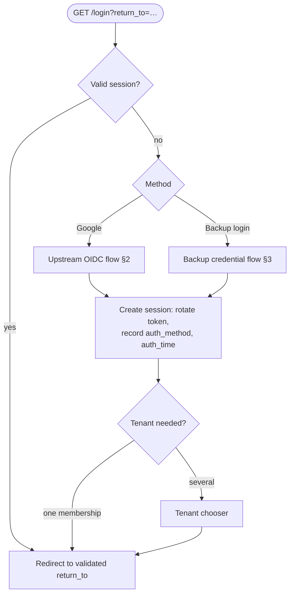
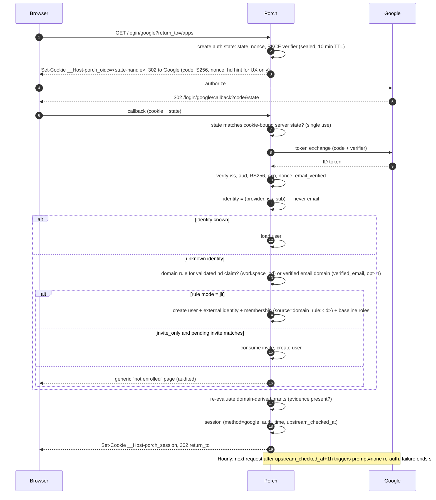
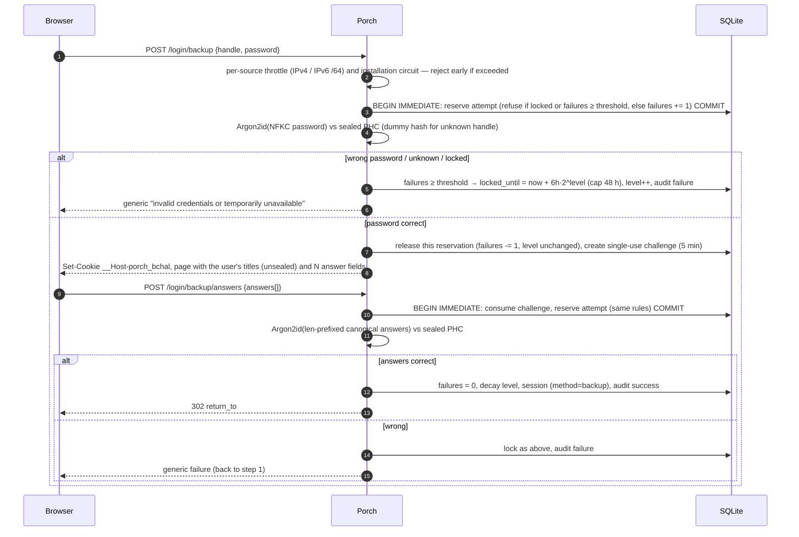
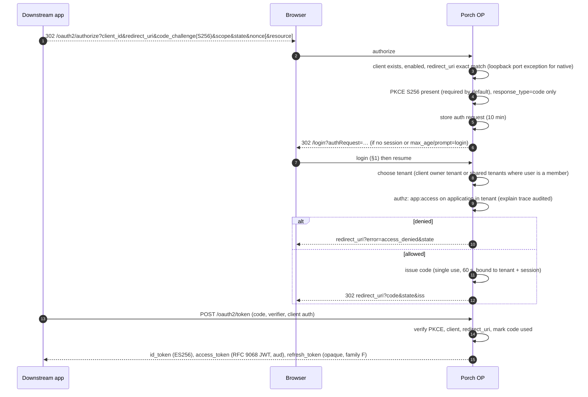
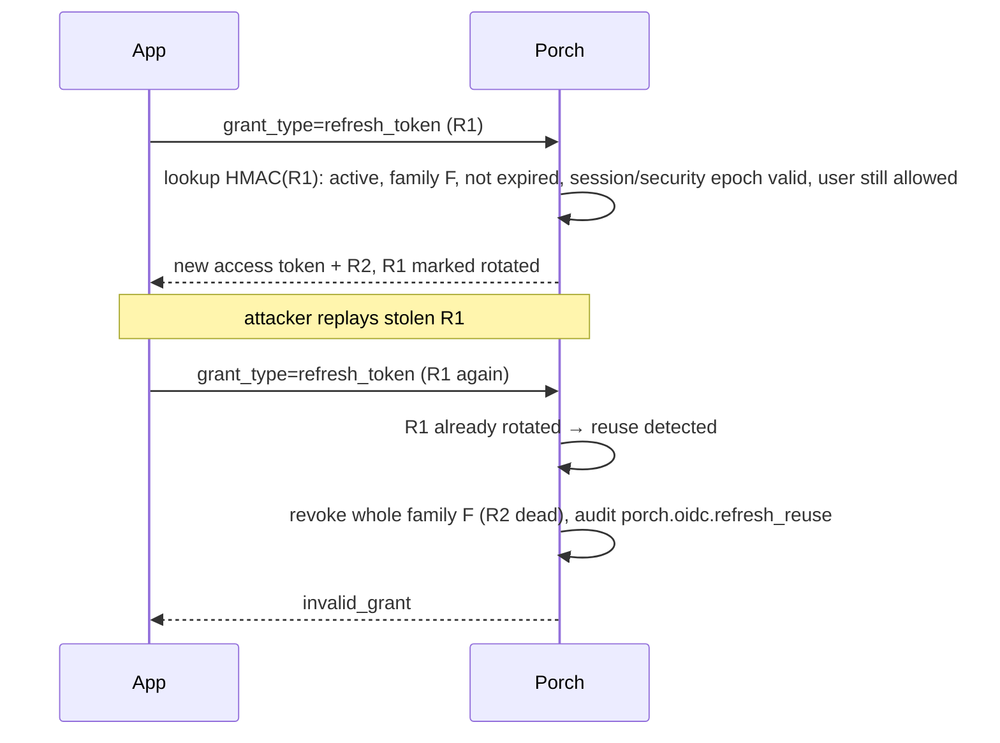
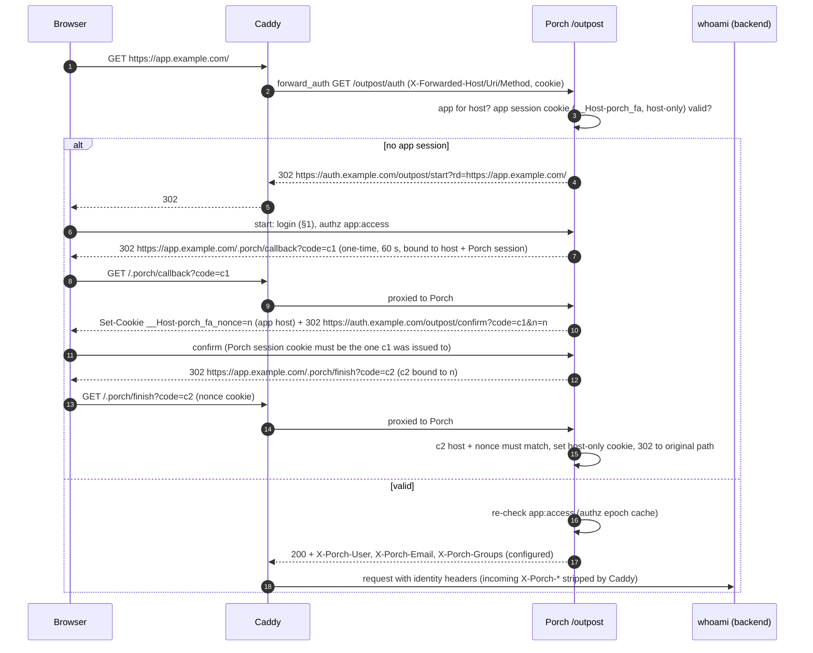
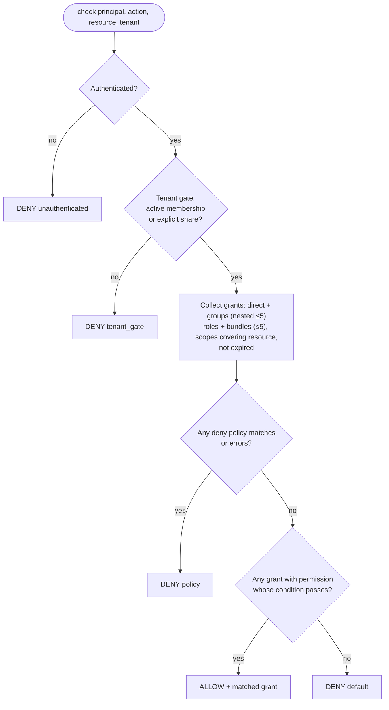
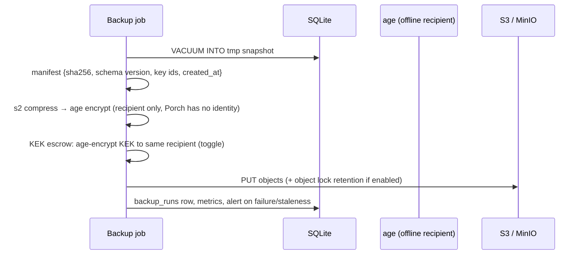
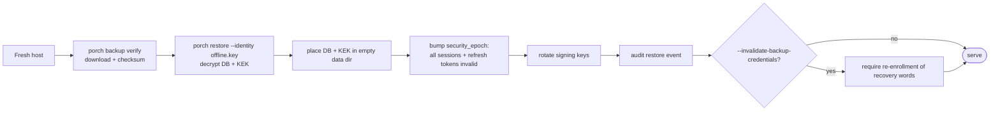

# Flows

Sequence diagrams for every security-relevant flow. They describe the **intended** design; the implementation status of
each flow is tracked in [IMPLEMENTATION_MATRIX.md](IMPLEMENTATION_MATRIX.md).

## 1. Browser login (entry point)

`return_to` must be a same-origin path (`/…`, not `//…`) or a URL on a registered application host.

## 2. Google (upstream OIDC) login and enrollment

## 3. Backup (local) login: password, then titled recovery answers

Both steps spend from the same attempt budget: a correct password never resets the counter, so it buys no extra answer
guesses. Lockout affects only the backup mechanism; Google login and existing sessions continue.

## 4. OIDC authorize (Porch as provider)

## 5. Refresh token rotation and reuse detection

## 6. Forward-auth (proxy outpost)

## 7. Authorization evaluation

Every decision returns an explain trace (tenant gate result, candidate grants, condition results, deny policies).

## 8. Backup and restore

