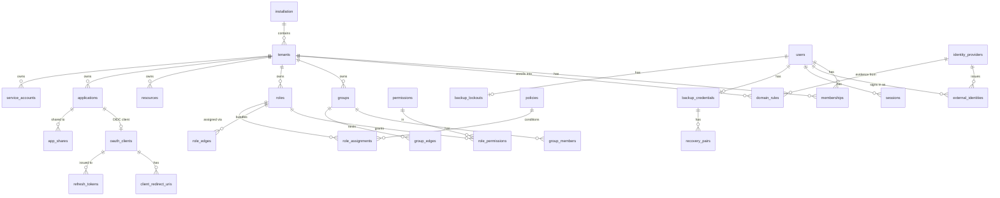

# Database schema

SQLite, `STRICT` tables, goose migrations in `internal/store/migrations` (forward-only). Conventions:

- IDs: `TEXT` `<prefix>_<26 base32>` (UUIDv7). Times: `INTEGER` UTC Unix microseconds (`*_at`).
- Tenant-scoped tables: `tenant_id TEXT NOT NULL`, `UNIQUE (tenant_id, id)`; references to other tenant-scoped rows are
  **composite FKs** `(tenant_id, x_id) REFERENCES x(tenant_id, id)` so cross-tenant references are impossible.
- Mutable admin resources carry `version INTEGER` (ETag), `managed_by TEXT` (`ui` | `api` | `terraform` | `system`),
  `last_changed_by TEXT`, `created_at`, `updated_at`.
- Sealed columns are `BLOB` named `*_enc` and listed in the keyring column registry.
- Bearer secrets (sessions, refresh tokens, codes, automation tokens) are stored as `*_mac BLOB` (HMAC-SHA-256 under the
  keyring `token` key).

## Entity overview

## Tables

### Platform
| Table | Purpose |
|---|---|
| `installation` | Singleton: installation id, `security_epoch`, setup state |
| `settings` | Key/value settings (incl. keyring canary) |
| `keyring_keys` | Wrapped purpose keys (`field`, `token`, `signing`, `backup-meta`), version, state |
| `audit_events` | Hash-chained audit log (seq, prev_hash, hash, actor, tenant, action, target, outcome, reason_code, source_ip, auth_method, request_id, details_json, details_enc) |
| `outbox` | Pending events: id (ULID), type, subject, payload, attempts, next_attempt_at, dead_at |
| `jobs` | Leased job queue |
| `backup_runs` | Backup attempts, object keys, sizes, sha256, status |
| `throttle_buckets` | Persistent rate-limit buckets (source, account, circuit) |
| `security_epochs` | Per-user epoch (sessions/refresh tokens older than the epoch are invalid) |
| `setup_tokens` | CLI-issued single-use setup tokens (MAC, expiry, consumed_at) |

### Tenancy and identity
| Table | Purpose |
|---|---|
| `tenants` | id, slug (unique), name, status, session policy overrides |
| `users` | Installation-wide user: id, public_id (`sub`), display_name, primary email, status, backup login handle |
| `user_emails` | Email attributes with `verified` and provenance (never used for identity) |
| `operators` / `installation_role_assignments` | Installation roles (`owner`, `admin`, `auditor`) — separate from tenant roles |
| `memberships` | (tenant, user) status, source |
| `identity_providers` | Upstream OIDC providers (kind `google` / `oidc`), issuer, client id, sealed client secret, allowed `hd`s |
| `external_identities` | (provider, issuer, subject) unique → user |
| `domain_rules` | domain (unique), tenant, provider, evidence_kind, mode, baseline role ids |
| `invites` | Pending invitations (email or domain, tenant, roles, expiry) |

### Authorization
| Table | Purpose |
|---|---|
| `permissions` | Catalogue `<resource_type>:<action>` (system + tenant-defined) |
| `roles`, `role_permissions`, `role_edges` | Roles, their permissions, role bundles (DAG, depth ≤ 5) |
| `groups`, `group_members`, `group_edges` | Groups, user/service-account membership (with source), nesting (DAG, depth ≤ 5) |
| `resources` | Tenant resources with type, optional parent, attributes JSON |
| `policies` | expr source, compiled hash, effect (`condition` / `deny`), env version |
| `role_assignments` | subject (user/group/service_account), role, scope (tenant / resource_type / resource), condition policy, expires_at, source |
| `authz_epochs` | Per-tenant authz epoch (cache invalidation) |

### Applications and OIDC
| Table | Purpose |
|---|---|
| `applications` | Tenant app: kind (`oidc` / `forward_auth`), launcher info (group, icon source and media, migration 0011), hosts (forward-auth), disclosure config |
| `media` | Re-encoded icons and background images keyed by SHA-256, with background credits (migration 0011, ADR-0045) |
| `oauth_clients` | client_id, type (confidential/public), sealed secret hash, allowed grants, signing alg, audiences, token lifetimes |
| `client_redirect_uris` | Exact redirect URIs and post-logout URIs |
| `app_shares` | (app, target tenant, granted_by) |
| `service_accounts` | Tenant service accounts (migration 0006, ADR-0037): slug, name, enabled, secret MAC + hint, audiences, access-token TTL, last_used_at; ID doubles as `client_id` |
| `automation_tokens` | `porch_at_` tokens: MAC, tenant, permissions, expiry |
| `auth_requests` | Pending authorize requests |
| `auth_codes` | Single-use codes (MAC), bound to request, tenant, session |
| `refresh_tokens` | MAC, family id, parent, state (`active`/`rotated`/`revoked`), client, tenant, user, scopes, expiry |
| `signing_keys` | kid, alg, sealed private key, public JWK, state (`next`/`active`/`retiring`/`retired`) |

### Sessions and local authentication
| Table | Purpose |
|---|---|
| `sessions` | MAC, user, tenant (current), method, auth_time, upstream_checked_at, csrf secret, idle/absolute expiry, epoch |
| `oidc_login_states` | Upstream login state: state MAC, sealed nonce + PKCE verifier, return_to, expiry |
| `backup_credentials` | user, sealed password PHC, sealed answers PHC, pair count, enrolled_at, rotated_at |
| `recovery_pairs` | user, position, sealed title (answers are only inside the combined verifier) |
| `backup_challenges` | Step-2 challenges: MAC, user, source, expiry, consumed_at |
| `backup_lockouts` | user, failures, locked_until, level |
| `recovery_links` | `porch admin recover` one-time links: MAC, user, expiry, consumed_at, acknowledged_at |
