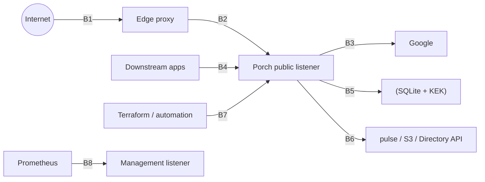

# Threat model

Method: STRIDE per trust boundary. Each threat has an ID (`T-<boundary>-<n>`), the mitigation, and the test or
document that covers it. Status values follow [IMPLEMENTATION_MATRIX.md](IMPLEMENTATION_MATRIX.md): a mitigation is only
"tested" when an automated test exists and passed.

## Assets

| Asset | Why it matters |
|---|---|
| KEK file | Unwraps every purpose key: field secrets, token MAC key, signing keys |
| Signing keys (ES256/RS256) | Forging ID/access tokens = impersonating any user at every downstream app |
| SQLite database | Users, grants, sessions (hashed), sealed secrets, audit chain |
| Session cookies, refresh tokens, automation tokens | Bearer credentials |
| Backup credential (password + recovery words) | Bypasses Google; strongest local login |
| Backups in S3 | Full copy of the DB + escrowed KEK (encrypted to an offline age recipient) |
| Audit log | Accountability; tamper evidence |

## Actors

- **Anonymous internet attacker** — can reach the public listener (through the proxy).
- **Malicious tenant member / tenant admin** — authenticated in tenant A, wants data or access in tenant B.
- **Malicious downstream app (RP)** — registered client that wants tokens for other audiences or other tenants.
- **Network attacker between proxy and Porch** — mitigated by loopback/private network or Cloudflare AOP + TLS.
- **Compromised Google account** — can log in as the federated identity.
- **Host administrator / host compromise** — out of scope for confidentiality; we provide tamper *evidence* only.

## Trust boundaries

## B1/B2 — Browser and proxy → Porch

| ID | STRIDE | Threat | Mitigation | Coverage |
|---|---|---|---|---|
| T-B2-1 | S | Spoofed client IP via `X-Forwarded-For` to dodge throttles or forge audit IPs | Trusted-proxy CIDR list; right-to-left walk; Cloudflare mode trusts `CF-Connecting-IP` only from configured CF ranges with AOP | `httpx` spoofing tests |
| T-B2-2 | S | Spoofed identity headers (`X-Porch-*`, `Remote-*`) reaching a forward-auth backend | Porch never reads inbound identity headers and overwrites the ones it sends; proxies must strip the rest (docs, Caddyfile); `/outpost/auth` only from trusted peers | `TestForwardAuthFlow`, `TestForwardAuthMisconfiguredProxyOverwrite`, `TestForwardAuthOutpostHardening` |
| T-B2-3 | T | CSRF on state-changing endpoints | `__Host-` SameSite=Lax cookies + Origin check + HMAC CSRF token (header) on every mutation | httpx/mgmtapi tests |
| T-B2-4 | T | Clickjacking of consent/login | `frame-ancestors 'none'`, `X-Frame-Options: DENY` | header tests |
| T-B2-5 | I | XSS leading to token theft | React escaping; strict CSP with per-request nonce, no inline scripts; HttpOnly cookies; no tokens in localStorage | CSP tests, e2e |
| T-B2-6 | I | Open redirect via `return_to`, `rd`, `post_logout_redirect_uri` | Return targets restricted to same-origin paths or registered hosts / exact registered URIs | open-redirect tests |
| T-B2-7 | D | Login flooding, Argon2 CPU exhaustion | Per-source + per-account throttles before hashing; bounded hash semaphore; body limits; server timeouts | throttle tests |
| T-B2-8 | E | Session fixation | Session rotated on login, step-up, privilege change; server-side hashed tokens | session tests |
| T-B2-9 | I | Account enumeration via backup login | Generic response; dummy hash for unknown users; same code path for locked accounts | enumeration tests |
| T-B2-11 | I | Password oracle in two-step backup login (titles shown after a correct password, ADR-0009) | Each step reserves from the same lockout budget; correct password never resets it; audited | concurrent lockout tests |
| T-B2-10 | S | Cookie tossing from sibling subdomain | `__Host-` prefix (no Domain, Path=/, Secure); forward-auth cookies host-only per app | cookie tests |

## B3 — Porch → Google (upstream OIDC)

| ID | STRIDE | Threat | Mitigation | Coverage |
|---|---|---|---|---|
| T-B3-1 | S | Forged ID token | go-oidc verifier: issuer, audience, RS256 allowlist, expiry, nonce; JWKS from discovery over TLS | fake IdP tests |
| T-B3-2 | S | Login CSRF / code injection | `state` + PKCE S256 + nonce stored server-side, bound to a short-lived `__Host-porch_oidc` cookie | tests |
| T-B3-3 | E | Domain takeover via email suffix or `hd=` request hint | Enrollment uses the validated `hd` **claim** only; `verified_email` mode is opt-in and labelled weaker | hd tests (missing/mismatch/hint-only) |
| T-B3-4 | E | Account takeover by matching email of an existing local user | Identity keyed by `(issuer, subject)`; no auto-link on email; linking needs step-up + fresh upstream auth | email-link-attack test |
| T-B3-5 | E | Workspace user removed upstream keeps access | Hourly `prompt=none` recheck; derived grants removed on evidence loss; optional Directory API sync | recheck tests (fake), real Google **not verified** |
| T-B3-6 | I | SSRF through provider discovery URL | Outbound guard denies private/loopback/link-local/CGNAT/NAT64 at dial time unless allowlisted (`outbound.allow_cidrs`) | `internal/netguard` tests |
| T-B3-7 | T/I | Fetched or uploaded images: SSRF through icon URLs, script content served as an image, decompression bombs, third-party tracking of visitors | Outbound guard on every fetch and redirect; size and pixel limits before decoding; raster images decoded and re-encoded to PNG/JPEG; SVG rewritten from an element allowlist without scripts, handlers, external references or DOCTYPEs; served from Porch's origin with `nosniff` and a sandboxing CSP, shown only via `` (ADR-0045) | `internal/appearance` tests, `TestApplicationIconsAndLauncherGroups` |

## B4 — Downstream apps (RPs) ↔ Porch OP

| ID | STRIDE | Threat | Mitigation | Coverage |
|---|---|---|---|---|
| T-B4-1 | S | Authorization code interception | PKCE S256 required for all clients by default; exact redirect URI match | protocol tests |
| T-B4-2 | S | Code replay | Codes single-use; reuse revokes tokens issued from that code | code-reuse test |
| T-B4-3 | E | Refresh token theft | Opaque, hashed, rotating; reuse of a rotated token revokes the whole family | refresh-reuse test |
| T-B4-4 | E | Token for app A accepted by app B | RFC 9068 JWT access tokens with `aud`; ID token `aud` = client; tenant bound in `porch.tenant` | audience tests |
| T-B4-5 | I | Over-disclosure of groups/roles to apps | Per-client disclosure config; roles filtered per audience; size cap | claims tests |
| T-B4-6 | E | Cross-tenant token use | Tokens bound to one tenant chosen at authorize; app must be owned by or shared to that tenant; membership checked | cross-tenant tests |
| T-B4-7 | S | Signing key compromise | Keys sealed in keyring; rotation with overlap; restore rotates keys | rotation test |
| T-B4-8 | I | Introspection used for scanning | Introspection requires confidential client / resource-server auth | tests |

## B5 — Porch ↔ storage and keys

| ID | STRIDE | Threat | Mitigation | Coverage |
|---|---|---|---|---|
| T-B5-1 | I | DB file theft | Secrets sealed with keys wrapped by a KEK stored outside the DB; token lookups via HMAC | keyring tests |
| T-B5-2 | T | Audit tampering inside the DB | Hash chain + sequence; verification command; JSONL sink and pulse as external copies | audit verify tests |
| T-B5-3 | T | Cross-tenant reference by ID | Composite FKs `(tenant_id, id)` | composite-FK tests |
| T-B5-4 | D | Two processes on one data dir | `flock`; network FS refused | store tests |
| T-B5-5 | E | Offline attack on backup credential from DB theft | Verifier sealed with the field key (pepper); Argon2id 64 MiB | docs, tests |

## B6 — Porch → pulse, S3, Directory API

| ID | STRIDE | Threat | Mitigation | Coverage |
|---|---|---|---|---|
| T-B6-1 | I | Secrets in events | Event payloads built from allowlisted fields; redaction tests | outbox tests |
| T-B6-2 | I | Backup read by S3 operator | age encryption to an offline recipient; Porch cannot decrypt its own backups | `TestBackupRestoreDrill` (objects are age ciphertext; wrong identity fails) |
| T-B6-3 | T | Backup tampering/rollback | Signed manifest with SHA-256 per object, object lock, restore bumps security epoch and rotates signing keys | `TestBackupRestoreDrill`, `scripts/backup-drill.sh` |
| T-B6-4 | D | Pulse outage blocks logins | Outbox decoupled; relay retries out of band with capped backoff; dead-letter + alert | `TestRelayRetriesThenPublishes`, `TestRelayDeadLetters` |
| T-B6-5 | T | Forged or tampered backup planted in the bucket (recipients are public) | Ed25519-signed manifest, verification key kept offline with the identity; per-object SHA-256; restore refuses unverified backups | `TestBackupRestoreDrill`, `scripts/backup-drill.sh` |
| T-B6-6 | E | Sessions, refresh tokens or signing keys from a leaked backup reused after restore | Restore bumps the security epoch and replaces signing keys; optional backup-login reset | `TestBackupRestoreDrill` |

## B6b — Delegated tenant administration (ADR-0038)

| ID | STRIDE | Threat | Mitigation | Coverage |
|---|---|---|---|---|
| T-B6b-1 | E | A tenant admin with `role:manage` grants themselves or a friend `*:*` (assign `admin`, define a role with more permissions, bundle `admin` into a role) | Escalation rule: may only grant what they hold unconditionally at tenant scope; 403 `privilege_escalation` | `TestDelegatedTenantAdministration`, `TestEscalationCheckProperty` |
| T-B6b-2 | E | Indirect escalation through groups (join or nest into a group that is assigned `admin`) | Group membership and nesting checked against everything the group and its ancestors confer | `TestDelegatedTenantAdministration` |
| T-B6b-3 | E | Loosening a condition policy (or deleting a deny policy) to widen existing grants | Policy changes require holding every permission of the roles referencing the condition / the deny's actions; step-up | `TestDelegatedTenantAdministration` (conditional grants not counted) |
| T-B6b-4 | D | A lesser admin demotes or locks out a greater one (remove assignment, delete group, add deny policy) | Removals and deny policies follow the same rule | `TestDelegatedTenantAdministration` |
| T-B6b-5 | I | Tenant enumeration by non-members | Delegated scope errors are 404, same as a missing tenant | `TestNonOperatorForbidden` |
| T-B6b-6 | E | Tenant admin acts installation-wide (shares, domain rules, tenant status, other users' sessions) | Operator-only endpoints | `TestDelegatedTenantSettings` |
| T-B6b-7 | S | Leaked service-account secret | Prefix `porch_sa_` for secret scanners; HMAC at rest; rotation needs step-up and is immediate; tokens short-lived and audience-bound; `last_used_at` and audit | `TestServiceAccounts` |

## B7 — Automation (Terraform)

| ID | STRIDE | Threat | Mitigation | Coverage |
|---|---|---|---|---|
| T-B7-1 | E | Long-lived broad automation token | Tenant tokens permission-scoped and limited to the creator's current rights; installation tokens admin/auditor only; mandatory expiry ≤ 366 d; HMAC at rest; revocation; refused for token issuance, role changes, key rotation and `/me` writes (ADR-0041) | `TestAutomationTokens` |
| T-B7-4 | E | Stolen token bypasses step-up | Accepted (ADR-0041): issuance needs step-up, prefix `porch_at_` for secret scanners, `last_used_ip`, audit actor `automation` | `TestAutomationTokens` |
| T-B7-2 | T | Lost update between UI and Terraform | `ETag`/`If-Match` on row version; `managed_by` drift warnings | API tests |
| T-B7-3 | I | Secret echo on retry | Idempotent replays of secret-bearing creates never return the secret again (`409 idempotent_secret_withheld` + `Location`); keys scoped per credential | `TestIdempotencyKeys` |

## B8 — Management listener

| ID | STRIDE | Threat | Mitigation | Coverage |
|---|---|---|---|---|
| T-B8-1 | I | Metrics leak tenant names/user IDs | Bounded, non-identifying labels only | metrics tests |
| T-B8-2 | E | pprof exposure | Off by default; loopback default bind | config tests |

## Explicit non-goals / residual risks

- Host root, a malicious Porch binary, or a stolen KEK + DB defeat confidentiality. The audit chain then provides
  evidence only up to the last external copy (JSONL sink, pulse, backups).
- Logical tenant isolation is not a security boundary against Porch bugs. Hostile tenants should run separate instances.
- Recovery answers are user-chosen and titled like security questions (ADR-0009): their entropy is an estimate, titles
  may point at socially discoverable facts, and answers stay valid until rotated. Step 2 reveals that a password guess
  was correct (accepted oracle). Restoring an old backup restores old answers unless `porch restore --invalidate-backup-logins` is used.
- Forward-auth protects only requests that pass through the proxy. Backends reachable directly bypass it.
- Real Google, real S3 providers and real Cloudflare behaviour are not verified by the automated suite.
