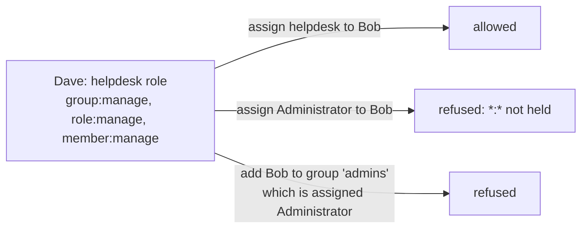

# Administer a tenant

A tenant (a family, a friend group, a homelab) is administered by its own members. Installation operators (the people
who run Porch) can do everything; everyone else needs a role in the tenant that grants the right permission.

<Shot name="members" alt="Tenant members: active and suspended, added by a domain rule or by hand" caption="Members, with how each one joined" />

## Who can do what

| Permission | Lets you |
|---|---|
| `member:manage` | add, suspend and remove members |
| `invite:manage` | invite people by email |
| `app:manage` | register applications (OpenID Connect or forward-auth), rotate client secrets |
| `group:manage` | create groups, add members, nest groups |
| `role:manage` | define roles and assign them; see effective permissions |
| `resource:manage` | define resources (folders, devices, …) that roles can be scoped to |
| `policy:manage` | write conditions and deny rules (needs a recent sign-in) |
| `service_account:manage` | create machine identities for scripts and APIs |
| `audit:read` | read this tenant's audit log |
| `authz:simulate` | use the access simulator |
| `tenant:manage` | rename the tenant and change its session lifetimes |

Each area also has a read-only permission: `app:read`, `member:read`, `invite:read`, `group:read`, `role:read`,
`resource:read`, `policy:read`, `service_account:read` and `tenant:read`. It shows the area in the admin UI and the
API without any way to change it. The matching `:manage` permission includes the read.

The built-in **Administrator** role grants everything (`*:*`). The built-in **Member** role is what every member has.

People holding only read permissions see the same pages without any control to change them:

<Shot name="readonly" alt="Applications page as an inspector sees it: read-only, with View instead of Manage" caption="A read-only view of the applications" />

## Groups, roles and assignments

Groups nest (a group's members are members of its parent groups too), roles bundle permissions, and an assignment
gives a role to a member, a group or a service account: across the tenant, for one resource type, or for one resource
and everything below it, optionally only while a condition policy holds and optionally until a date.

<div class="pc-gallery">
<Shot name="groups" alt="Group dialog: direct members and the parent group it is nested in" caption="Parents is nested in Family" />
<Shot name="assignments" alt="Role assignments to groups, a member and a service account, with conditions, scopes and an expiry" caption="Assignments with scopes, a condition and an expiry" />
<Shot name="resources" alt="Resources indented by parent: albums inside a photo library" caption="Resources: albums inside a photo library" />
<Shot name="simulator" alt="Access simulator explaining why a request is allowed" caption="The simulator explains every decision" />
</div>

## You can only hand out what you hold

Porch refuses any change that would give someone more than you have yourself:

- assigning a role, or defining a role, with permissions you do not hold;
- adding someone to a group (or nesting a group under another) that is assigned such a role;
- removing an assignment, deleting a group or a role that carries permissions you do not hold;
- writing a deny rule for actions you do not hold, or loosening a condition that other people's roles depend on.

Grants you hold only under a condition (for example "only from the home network") or only on one resource do not
count. The API answers `403 privilege_escalation` and names what is missing; the admin UI shows the same message.



Some things stay with installation operators because they affect every tenant: enabling or disabling a tenant,
sharing an application with another tenant, domain rules, identity providers, user accounts and other users' sessions.

## Installation roles

Installation operators hold one of these roles, which owners grant under **Operators**:

| Role | Can |
|---|---|
| `owner` | everything, including granting installation roles and rotating signing keys |
| `admin` | manage every tenant, user, identity provider, domain rule and session |
| `auditor` | read installation health, alerts, backups and the audit log |
| `inspector` | read the configuration of every tenant (applications, service accounts, members, groups, roles, assignments, resources, policies, invitations, shares, domain rules) and the identity providers, without changing anything |

Neither read-only role sees secrets: Porch shows client secrets only once, when they are created.

<Shot name="operators" alt="Installation operators: owner, admin and inspector" caption="Installation operators" />

## Service accounts

A service account is a tenant identity for a script or an API client. It gets a secret once, then requests access
tokens with the OAuth 2.0 client credentials grant:

```sh
curl -u "$SERVICE_ACCOUNT_ID:$SECRET" \
  -d grant_type=client_credentials \
  -d resource=https://api.smith.example \
  https://auth.example.com/oauth2/token
```

Tokens are short-lived JWTs (`sub` and `client_id` are the service account ID) for one of the audiences you
registered. Give the service account roles on the **Assignments** page like any member; disable it to stop it at once.
