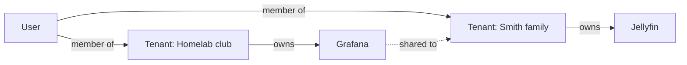

# Concepts

| Concept | Meaning |
|---|---|
| Installation | One running Porch with its database and key file |
| Operator | Someone who administers the installation itself (installation roles are separate from tenant roles) |
| Tenant | A family, friend group or homelab; owns its apps, groups, roles and policies |
| User | A person; can be a member of several tenants |
| Identity | A login method bound to a user: a Google account (issuer + subject) or the local backup login |
| Domain rule | "People with a validated Workspace domain `example.com` may join tenant X" |
| Application | Something users open: an OIDC client or a forward-auth protected host |
| Share | Explicit permission for another tenant's members to use an application |
| Role / bundle / group | RBAC building blocks; groups and bundles nest up to 5 levels |
| Policy | An `expr` condition on a grant, or a deny rule |
| Explain trace | Why a decision was allow or deny |

