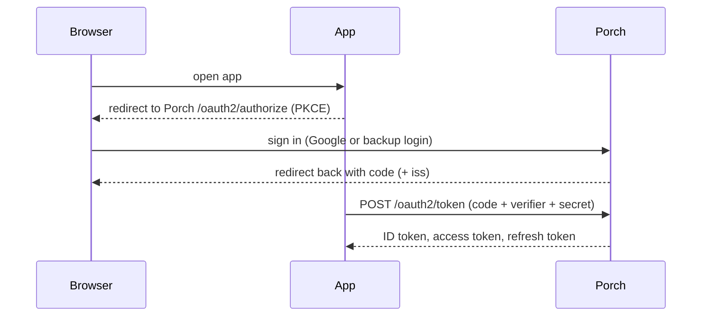

# Connect an application (OpenID Connect)

Most self-hosted apps can sign users in with "generic OAuth2 / OpenID Connect". Register the app in Porch, then copy
three values into the app.



## 1. Register

In the admin UI (tenant → **Applications** → **New application**), or through the API:

```http
POST /api/v1/tenants/smith/applications
Content-Type: application/json

{
  "slug": "grafana",
  "name": "Grafana",
  "kind": "oidc",
  "client": {
    "redirect_uris": ["https://grafana.example.com/login/generic_oauth"],
    "post_logout_redirect_uris": ["https://grafana.example.com/login"],
    "grant_types": ["authorization_code", "refresh_token"]
  },
  "disclosure": { "email": true, "groups": true, "roles": true, "entitlements": false }
}
```

The response contains `client.client_id` and — **only this once** — `client_secret`.

## 2. Configure the app

| Setting | Value |
|---|---|
| Issuer / discovery | `https://auth.example.com` (`/.well-known/openid-configuration`) |
| Client ID / secret | from step 1 |
| Scopes | `openid profile email` (+ `offline_access` for refresh tokens, `groups` for group slugs) |
| PKCE | S256 (required by default) |
| Signing algorithm | ES256 (set `signing_alg: RS256` on the client for apps that only support RSA) |

## 3. Decide who may open it

Every application, OpenID Connect or forward-auth, has an access mode (`access_mode`, **Access** in the admin UI):

| Mode | Who may open the app |
|---|---|
| `all_members` (default) | every active member of the tenant, and of the tenants the app is [shared](./concepts) with |
| `assigned` | only people (or groups) holding `app:access` on that application through an assignment |

For `assigned`, create a role with the `app:access` permission and assign it on **Assignments** with the scope
*a single resource* of type `app`, the application itself. Deny policies on `app:access` apply in both modes, so a
condition such as "only from the home network" can narrow an app that every member may otherwise open.

<Shot name="applications" alt="Applications of a tenant: OIDC and forward-auth, open to all members or only to assigned people" caption="Grafana and Vaultwarden are open only to the people assigned to them" />

## What the app receives

- `sub`: a stable Porch user ID (`u_…`) — never an email.
- `email`, `email_verified`, `name` per scopes and the app's disclosure settings.
- `porch`: `{ "v": 1, "tenant": { "id": "ten_…", "slug": "smith" }, "roles": [ … ], "groups": [ … ] }`.
- Access tokens are JWTs with `typ: at+jwt` (RFC 9068) whose `aud` is the API you asked for with `resource`, or the
  client ID. Validate them against `/jwks`.

Rules worth knowing: redirect URIs match exactly; codes are single-use (reusing one revokes the tokens it produced);
refresh tokens rotate and reusing an old one revokes the whole chain; users must be members of the app's tenant.

A runnable demo app lives in `examples/demo-app`.
