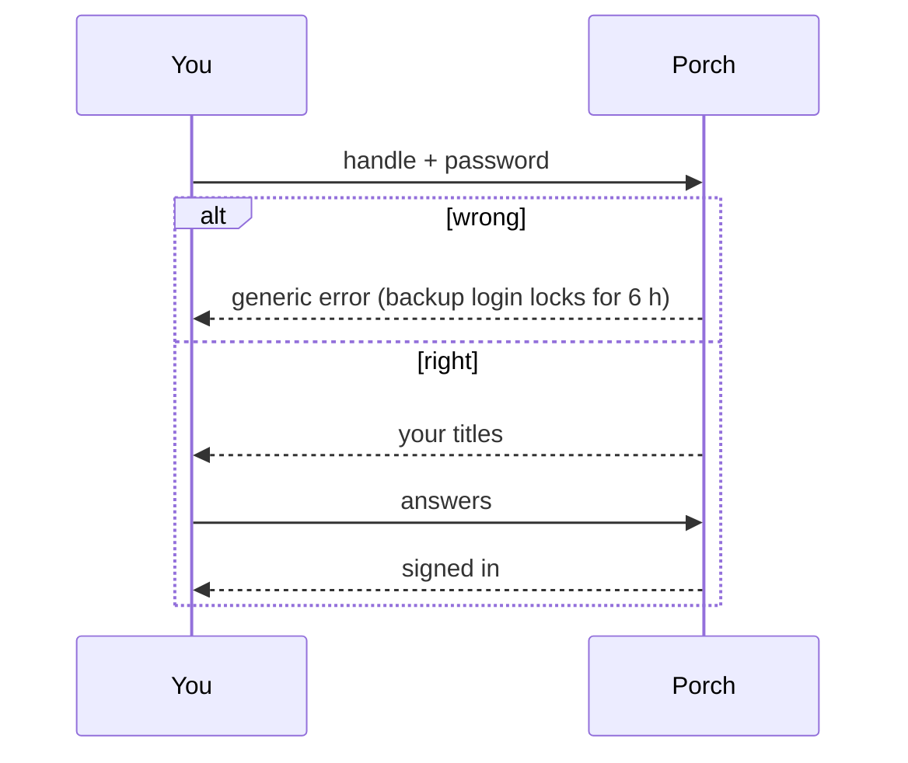

# Signing in

Porch offers two ways in. Most people only ever use the first.

<Shot name="login" alt="Sign-in page with Google and the backup login" caption="The sign-in page" />

## Google (or another OpenID provider)

Click **Continue with Google**. If your Google Workspace domain is enrolled into a group (tenant), you join it
automatically the first time; otherwise an administrator invites your email first.

- Porch identifies you by your Google account ID, never by your email address, so somebody else's account that claims
  your email can never take over yours.
- About once an hour Porch silently re-confirms your account with Google. If your Workspace account was removed, your
  Porch session ends.
- Already have a Porch account (for example you set Porch up)? Link Google first under **Account → Linked sign-in
  accounts**; a first Google sign-in with your email is refused instead of creating a second account.
- If the sign-in page goes straight to Google, `/login?all=1` shows every way in, including the backup login.

After signing in you see the launcher: every application you may open, from every tenant you belong to, grouped as
your administrators arranged them. It fits a phone screen too.

<Shot name="launcher" alt="Porch launcher: the applications Ada may open, grouped by section" caption="The launcher" />

<Shot name="mobile-launcher" alt="The launcher on a phone" caption="On a phone" />

## Backup login

For when Google is unavailable. It has three parts, all chosen by you:

1. a **backup password**,
2. at least three **recovery questions**: a *title* you write yourself (like "Street of the summer house") and its
   *answer*,
3. optionally a **handle** to use instead of your email.

At sign-in you enter your handle (or email) and password. Only if the password is right does Porch show your titles
and ask for the answers. Answers ignore case, spaces and punctuation.

::: warning Strict on purpose
One wrong password or wrong set of answers locks the backup login for **6 hours** (then 12, 24, up to 48 hours).
Google sign-in keeps working during a lock, and an administrator can unlock you. Answers you choose yourself are weaker
than random words — Porch can suggest random words if you like.
:::

Set it up under **Account → Backup login**. Changing it needs a fresh sign-in. The account page also lists the
browsers you are signed in to and the applications that keep you signed in in the background, and lets you end
either.

<Shot name="account" alt="Account page with the linked Google account, the backup login and signed-in browsers" caption="The account page" />
