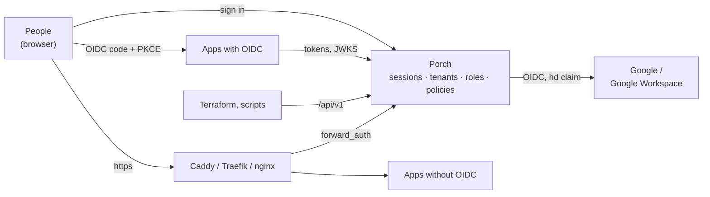

## How it works

1. Run `porch` behind your reverse proxy, create the owner with a one-time setup token and add Google as an identity
   provider.
2. Create a **tenant** per family or group. Invite people, or let a domain rule enroll everyone whose Google Workspace
   token carries `hd=smith.example`.
3. Register **applications**: OIDC clients get a client ID and secret, forward-auth apps get a host name. Decide who may
   open each one with roles, groups and conditions.
4. People sign in once and see a launcher with their apps. Porch issues tokens or identity headers that say who they
   are and which tenant let them in.

## See it

<Shot name="launcher" alt="Porch launcher: the applications Ada may open" caption="The launcher: every app you may open, from every tenant you belong to" />

<Shot name="login" alt="Sign-in page with Google and the backup login" caption="Sign in with Google or the backup login" />
<Shot name="account" alt="Account page with the linked Google account, the backup login and signed-in browsers" caption="Your account, backup login and sessions" />
<Shot name="members" alt="Tenant members: active and suspended, added by a domain rule or by hand" caption="Members and where they came from" />
<Shot name="applications" alt="Applications of a tenant: OIDC and forward-auth, open to all members or only to assigned people" caption="OIDC and forward-auth applications" />
<Shot name="groups" alt="Group dialog: direct members and the parent group it is nested in" caption="Nested groups" />
<Shot name="roles" alt="Role editor with the permission picker" caption="Roles built from permissions" />
<Shot name="assignments" alt="Role assignments to groups, a member and a service account, with conditions, scopes and an expiry" caption="Assignments with scopes, conditions and expiry" />
<Shot name="resources" alt="Resources indented by parent: albums inside a photo library" caption="Resource hierarchies" />
<Shot name="policy" alt="Condition policy with an expr expression and live validation" caption="Conditions with live validation" />
<Shot name="simulator" alt="Access simulator explaining why a request is allowed" caption="Every decision explained" />
<Shot name="domains" alt="Domain rules: everyone with a smith.example Google Workspace account joins on first sign-in" caption="Enroll a whole Workspace domain" />
<Shot name="readonly" alt="Applications page as an inspector sees it: read-only, with View instead of Manage" caption="Read-only access for inspectors" />
<Shot name="tokens" alt="Automation tokens, one issued by the Terraform token" caption="Tokens that issue tokens" />
<Shot name="operators" alt="Installation operators: owner, admin and inspector" caption="Installation roles" />
<Shot name="audit" alt="Audit explorer with an expanded event" caption="Hash-chained audit log" />
<Shot name="health" alt="System health: checks, keyring and storage" caption="System health" />
<Shot name="appearance" alt="Appearance settings: image providers and the current background images with credits" caption="Background providers and credits" />

<Shot name="mobile-launcher" alt="The launcher on a phone" caption="The launcher on a phone" />
<Shot name="mobile-admin" alt="Administration on a phone: one card per application" caption="Administration on a phone" />

