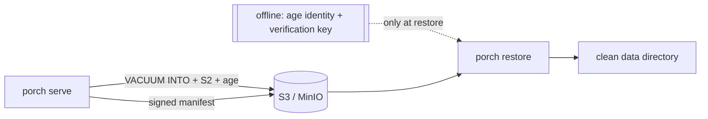

# Backups and restore

Porch backs up its database (and, by default, its key-encryption key) to any S3-compatible storage. Backups are
encrypted with [age](https://age-encryption.org) to a key you keep **offline**: Porch can write backups but cannot read
them back.



## Set up

```sh
porch backup keygen -out backup.agekey   # prints the recipient; move backup.agekey OFFLINE
```

```yaml
backup:
  enabled: true
  interval: 6h          # also your recovery point objective
  retention: 28         # complete backups kept
  recipients: [age1...]
  s3:
    endpoint: s3.eu-central-1.amazonaws.com
    bucket: porch-backups
    prefix: porch/
    region: eu-central-1
    access_key_id: AKIA...
    secret_access_key_file: /run/secrets/porch_s3_secret
```

After the first start, copy the **verification key** from **Administration → Backups** (also in the server log and
`porch backup verify-key`) next to the age identity. Restores refuse backups that this key does not verify: the age
recipient is public, so without it anyone able to write to the bucket could plant a forged installation.

Enable bucket versioning and object lock if your provider supports them.

## Restore

See the [backup runbook](https://github.com/aurimasniekis/go-porch/blob/main/docs/runbooks/porch-backups.md). In
short: `porch restore -config porch.yaml -identity backup.agekey -verify-key porch-backup-ed25519:…` into an empty
data directory, then `porch serve`. The first start invalidates every session and refresh token from the backup,
replaces the signing keys and raises a critical alert.

## What is not verified

Backups are tested against MinIO (`scripts/backup-drill.sh`). Other S3 providers (AWS, Backblaze, Wasabi, …) are
**not verified**.
