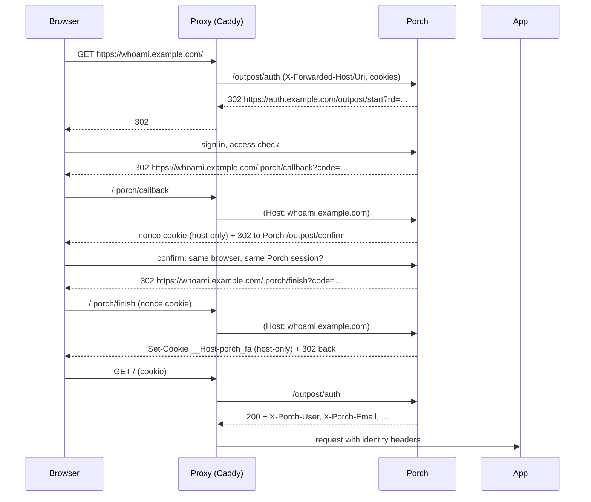

# Protect an app with forward-auth

For apps without OpenID Connect support (dashboards, `whoami`, admin UIs) the reverse proxy asks Porch before every
request.



## Register the app

```http
POST /api/v1/tenants/smith/applications
{ "slug": "whoami", "name": "Whoami", "kind": "forward_auth", "hosts": ["whoami.example.com"],
  "access_mode": "all_members" }
```

`access_mode: assigned` restricts the app to users or groups granted `app:access` explicitly.

## Caddy

```caddyfile
whoami.example.com {
	# Never let clients send identity headers.
	request_header -X-Porch-*
	request_header -Remote-*

	# Porch's callback must be reached on this host (Host header preserved).
	handle /.porch/* {
		reverse_proxy porch:8080
	}

	handle {
		forward_auth porch:8080 {
			uri /outpost/auth
			copy_headers X-Porch-User X-Porch-Email X-Porch-Name X-Porch-Groups X-Porch-Tenant
		}
		# The forward-auth cookie is for Porch only; do not hand it to the backend.
		reverse_proxy whoami:80 {
			header_up Cookie "__Host-porch_fa=[^;]*(;\s*)?" ""
		}
	}
}
```

## Traefik

```yaml
http:
  middlewares:
    porch:
      forwardAuth:
        address: http://porch:8080/outpost/auth
        authResponseHeaders: [X-Porch-User, X-Porch-Email, X-Porch-Name, X-Porch-Groups, X-Porch-Tenant]
  routers:
    whoami-callback:
      rule: Host(`whoami.example.com`) && PathPrefix(`/.porch/`)
      service: porch
    whoami:
      rule: Host(`whoami.example.com`)
      middlewares: [porch]
      service: whoami
```

Traefik only forwards `X-Forwarded-*` from trusted IPs; also add a `headers` middleware that removes `X-Porch-*`.
Traefik has no built-in way to remove one cookie, so the backend receives `__Host-porch_fa`; treat the backend as
trusted, or put a cookie-filtering plugin in front of it.

## nginx

```nginx
# http {} context: drop Porch's forward-auth cookie from what the backend sees.
map $http_cookie $porch_backend_cookie {
    default $http_cookie;
    "~^(?<pc_a>.*?)__Host-porch_fa=[^;]*(?:;\s*)?(?<pc_b>.*)$" "$pc_a${pc_b}";
}

location = /_porch_auth {
    internal;
    proxy_pass http://porch:8080/outpost/auth;
    proxy_pass_request_body off;
    proxy_set_header Content-Length "";
    proxy_set_header X-Forwarded-Proto $scheme;      # always set all three: they overwrite client values
    proxy_set_header X-Forwarded-Host $http_host;
    proxy_set_header X-Forwarded-Uri $request_uri;
}
location /.porch/ { proxy_pass http://porch:8080; proxy_set_header Host $host; }
location / {
    auth_request /_porch_auth;
    auth_request_set $porch_user $upstream_http_x_porch_user;
    error_page 401 = @porch_login;
    proxy_set_header X-Porch-User $porch_user;   # overwrites any client value
    proxy_set_header Cookie $porch_backend_cookie;
    proxy_pass http://whoami;
}
location @porch_login { return 302 https://auth.example.com/outpost/start?rd=$scheme://$http_host$request_uri; }
```

nginx `auth_request` cannot relay a redirect, so it maps 401 to the sign-in URL.

The Caddy `header_up Cookie` and nginx `map` rules above were checked against Caddy 2.11.7 and nginx 1.27.3 with the
cookie first, last, in the middle and absent. The cookie is host-only and `HttpOnly`, but a backend that logs or
forwards request cookies would otherwise hold a live Porch forward-auth session for that host.

::: warning
Porch reads the original request **only** from `X-Forwarded-Proto`, `X-Forwarded-Host` and `X-Forwarded-Uri`, which the
proxy must set itself. It ignores `X-Original-URL` and similar headers, because Caddy and Traefik copy client headers
into the auth request.
:::

## Porch configuration

```yaml
proxy:
  trusted_proxies: [172.20.0.0/16]   # the proxy's network
forward_auth:
  trusted_peers: []                   # default: proxy.trusted_proxies (+ loopback)
  session_ttl: 12h
```

::: danger Things forward-auth cannot do
- If the app is reachable without the proxy (published port, LAN address), anyone can bypass Porch. Bind backends to
  the proxy network only.
- "Allowed by the proxy" is not "logged in to the app": apps with their own accounts must trust the identity headers
  (e.g. Grafana `auth.proxy`) or use OpenID Connect instead.
:::
