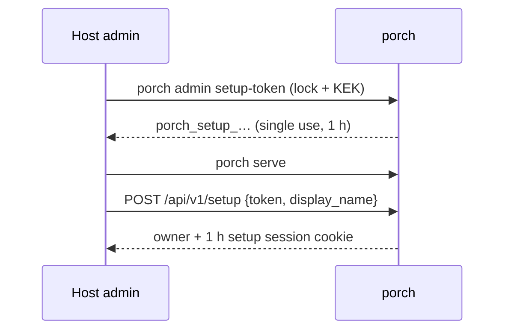

# Quickstart (development build)

::: warning
Pre-alpha. These steps describe what works today: bootstrap, tenants, users, memberships, Google login and the backup login through the
UI and API.
:::

```sh
# 1. A key-encryption key, outside the data directory, mode 0400
porch keys init --out /etc/porch/kek

# 2. Configuration
cat > /etc/porch/porch.yaml <<'YAML'
public_url: https://auth.example.com
data_dir: /var/lib/porch
kek:
  file: /etc/porch/kek
YAML
porch config check -config /etc/porch/porch.yaml

# 3. First owner: issue a setup token *before* the first start (it needs the data-directory lock)
porch admin setup-token -config /etc/porch/porch.yaml

# 4. Run
porch serve -config /etc/porch/porch.yaml
```

Then open `https://auth.example.com/setup` and paste the token. The public listener defaults to
`127.0.0.1:8080`; metrics and health live on the private management listener `127.0.0.1:9464`
(`/metrics`, `/healthz`, `/readyz`).


