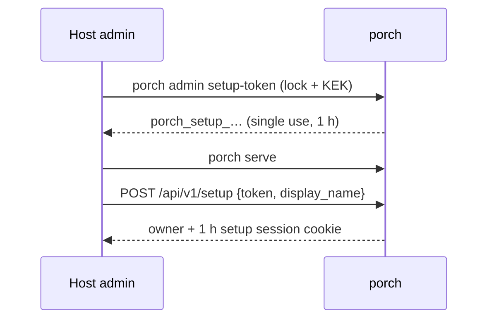

# Install

Porch is one binary with an embedded web UI and one SQLite database. Run **exactly one** instance per data directory,
behind a TLS reverse proxy (or with Porch's own TLS). The key-encryption key (KEK) lives outside the data directory:
without it the database cannot be read, so back it up offline as soon as you create it.

::: tip Releases
Porch 0.1.1 is the current release. Each release publishes the image `ghcr.io/aurimasniekis/go-porch` (also on Docker
Hub as `docker.io/aurimasniekis/porch`; linux/amd64, linux/arm64) and archives for linux/amd64, linux/arm64 and darwin/arm64 on the
[releases page](https://github.com/aurimasniekis/go-porch/releases), with `SHA256SUMS`, SBOMs and build provenance.
:::

Want to look around first? [Try it locally](../guide/try-locally) with the demo stack.

## Docker Compose

`deploy/compose.yaml` runs Porch read-only, as UID 65532, with all capabilities dropped. The public listener is
published on `127.0.0.1:28080` for your reverse proxy.

```sh
export V=0.1.1
gh attestation verify oci://ghcr.io/aurimasniekis/go-porch:$V --repo aurimasniekis/go-porch   # optional
git clone --depth 1 --branch v$V https://github.com/aurimasniekis/go-porch.git && cd go-porch/deploy
cp .env.example .env && $EDITOR .env                          # PD_PUBLIC_URL=https://auth.example.com
printf 'PD_IMAGE=ghcr.io/aurimasniekis/go-porch\nPD_VERSION=%s\n' "$V" >> .env
install -d -m 0700 secrets && sudo chown 65532:65532 secrets  # Linux; not needed with Docker Desktop
docker compose pull                                           # or `docker compose build` from source
docker compose --profile init run --rm keygen                 # secrets/porch.kek (0400): back it up offline
docker compose run --rm --no-deps porch admin setup-token     # one-time setup token; Porch must not be running
docker compose up -d && docker compose ps
```

Then open `https://auth.example.com/setup`, paste the token and create the owner account. Details, hardening and the
network layout: [deploy/README.md](https://github.com/aurimasniekis/go-porch/blob/main/deploy/README.md).

## Binary with systemd

Needs Go (the version in `go.mod`), Node 24 and pnpm.

```sh
git clone https://github.com/aurimasniekis/go-porch.git && cd go-porch
make build                                         # web UI + bin/porch
sudo install -m 0755 bin/porch /usr/local/bin/porch
```

```sh
# 1. A dedicated user and the configuration directory
sudo useradd --system --home-dir /var/lib/porch --shell /usr/sbin/nologin porch
sudo install -d -m 0750 -o root -g porch /etc/porch
cat > porch.yaml <<'YAML'
public_url: https://auth.example.com
data_dir: /var/lib/porch
kek:
  file: /etc/porch/kek
proxy:
  trusted_proxies: [127.0.0.1/32]   # your reverse proxy
YAML
sudo install -m 0640 -o root -g porch porch.yaml /etc/porch/porch.yaml

# 2. The KEK, outside the data directory, owned by porch, mode 0400. Back it up offline.
sudo -u porch porch keys init --out /tmp/porch.kek
sudo install -m 0400 -o porch -g porch /tmp/porch.kek /etc/porch/kek && sudo shred -u /tmp/porch.kek
sudo -u porch porch config check -config /etc/porch/porch.yaml

# 3. First owner: issue a setup token before the first start (it needs the data-directory lock)
sudo install -d -m 0700 -o porch -g porch /var/lib/porch
sudo -u porch porch admin setup-token -config /etc/porch/porch.yaml

# 4. Run it as a service
sudo install -m 0644 deploy/systemd/porch.service /etc/systemd/system/porch.service
sudo systemctl daemon-reload && sudo systemctl enable --now porch
porch healthcheck                     # probes http://127.0.0.1:9464/readyz
```

The unit is sandboxed (`systemd-analyze security` exposure 1.4). Its README covers file permissions and delivering
the KEK with `LoadCredential=`:
[deploy/systemd/README.md](https://github.com/aurimasniekis/go-porch/blob/main/deploy/systemd/README.md).

## Listeners

| Listener | Default | Serves |
| --- | --- | --- |
| Public | `127.0.0.1:8080` | sign-in, portal, admin UI, `/api/v1`, OIDC endpoints, forward-auth outpost |
| Management | `127.0.0.1:9464` | `/metrics`, `/healthz`, `/readyz` (keep it private) |

Set `public_url` to the external https origin: it is also the OIDC issuer. Configure `proxy.trusted_proxies` so
Porch takes the client IP from your proxy only. Behind Cloudflare, see
[the threat model](../security/threat-model) for Authenticated Origin Pulls.



## Next steps

1. [Add Google as an identity provider and enroll your domain](./identity-providers).
2. Create a tenant, invite people or add a domain rule ([Administer a tenant](../guide/administration)).
3. [Connect your first application](../guide/connect-an-app), or protect one with [forward-auth](./forward-auth).
4. Enroll your own [backup login](./recovery) and [configure backups](./backups).
